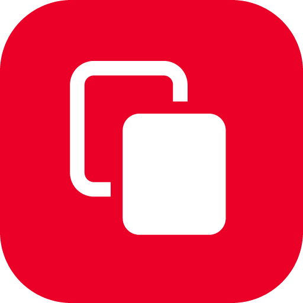

<p align="center"></p>

<h1 align="center">Clipverse</h1>
<p align="center"><b>Copy on one device. Paste on another.</b><br>
Self-hosted clipboard and image sync for Android and any Chromium browser.<br>
It runs on your own Cloudflare account (free tier, no card) and uses almost no phone battery.</p>

---

Clipverse syncs text, links, 2FA codes and images between Android phones (Android 13 to 17+) and
desktop browsers (Chrome, Edge, Brave, Arc, Vivaldi on macOS, Windows, Linux and ChromeOS). It works over
mobile data, Wi-Fi and VPNs. Your devices don't need to be on the same network.

**→ New here? Follow the step-by-step [install guide](docs/INSTALL.md)** (download, set up your free private server,
install the extension and the app).

> Inspired by **Clipt** from OnePlus OneLab (2021–2023), which used each user's Google Drive and was shut down in
> September 2023. Clipverse is an independent re-implementation. It is **not affiliated with OnePlus**, and it uses
> no OnePlus code or assets.

## Features

| | Android | Chrome extension |
|---|---|---|
| Automatic sync | **Auto-send what I copy** (via Shizuku) · **Auto-paste from computer** (via push) | **Auto-send what I copy** · **Auto-paste from phone** |
| Send by hand | Text-selection menu → **Send to Clipverse**, Share sheet, Quick Settings tile, **Paste & send** | Popup paste box, **Send clipboard**, right-click, `⌘⇧Y` / `Alt+Shift+C` |
| Images | Share sheet, photo picker (shrunk to WebP on the phone) | Paste a screenshot, drag & drop, right-click any image |
| Receive by hand | Open the app, pull to refresh, **Copy latest** widget and shortcut | Notification + badge, `⌘⇧L` / `Alt+Shift+V` |
| Manage | Search, filters (All / Text / Images / Pinned), pin, delete, full-screen viewer, save to gallery | Same, plus download |

- **Pair anything, from any network.** Scan one QR, or type a one-time code like `yourname-K7Q4MX` on a new phone
  *or* in Chrome on another Windows/Mac/Linux computer. Codes work once and expire after 10 minutes.
- **30-day auto-expiry.** Unpinned clips are deleted after 30 days by a Cloudflare cron job. Pinned clips are kept.
- **Themes.** System, Light, Dark and AMOLED (pure black) in both the app and the extension.
- **No accounts, no analytics.** Every request carries one secret token that only you know.

## How it works

```
 Android app ──HTTPS──┐                      ┌──HTTPS── Chrome extension
                      │   Cloudflare Worker  │   (offscreen document while Chrome is open:
 Shizuku watcher ─────┼──▶  Hono API  ◀──────┤    clipboard watch 1 s, server check 4 s;
 (optional auto-send) │     │       │        │    both slow down when you're idle)
 FCM push ◀───────────┘     ▼       ▼        │
 (optional auto-paste)  D1 (SQLite) KV (images)     Cron: every 6 h, delete expired clips
```

| Folder | What's in it |
|---|---|
| `backend/` | Cloudflare Worker (Hono + D1 + Workers KV + Cron Triggers), TypeScript |
| `chrome-extension/` | Manifest V3 extension (React, Vite, Tailwind). Popup, service worker, offscreen document |
| `android-app/` | Kotlin, Jetpack Compose, Material 3. minSdk 33, targetSdk 36 |
| `.github/workflows/` | CI. Builds the APK and the extension zip, and attaches both to GitHub Releases on `v*` tags |

## Automatic sync

**Computer → phone.** The extension notices new text on the desktop clipboard and uploads it. The server sends the
phone one Firebase push message, and the phone writes the text to its clipboard in the background, ready to paste.
Needs [push](#optional-instant-push-to-android).

**Phone → computer.** Android (10+) lets only the app in front read the clipboard, so automatic capture needs help:

- **Shizuku (recommended).** If the [Shizuku](https://shizuku.rikka.app) app is running, Clipverse starts a tiny
  clipboard listener inside it, running as the system *shell* user, which is allowed to read the clipboard in the
  background. It's event-driven (no polling) and keeps working when Clipverse is closed. After a phone restart,
  start Shizuku again and open Clipverse once.
- **Fallback without Shizuku.** A foreground service watches the system log for clipboard events and briefly
  takes focus with an invisible window to read the copy. It needs a one-time
  `adb shell pm grant app.clipt android.permission.READ_LOGS` and "Display over other apps". It doesn't work on
  phones that mute system logs (for example vivo), which is why Shizuku is preferred.

Text you copy from a clip that arrived from another device is never sent back, so there are no echo loops.
Automatic sync covers text; send images by hand.

## Battery design (Android)

With automatic sending off (the default), the app never runs in the background ("wake, act, exit"):

- **No** background service, polling, WebSocket, wake lock, exact alarm or accessibility service.
- **Sending.** The share sheet, text-selection menu, tile and shortcut each open an invisible activity, start one
  expedited WorkManager job and finish immediately. Photos are shrunk on the phone first (2560 px WebP, ~10× smaller),
  so the cellular radio is on for much less time.
- **Receiving.** Only when you open the app, pull to refresh, tap **Copy latest**, or a push arrives. Push uses the
  connection Google Play services already keeps open; Firebase isn't initialised at app start.
- **Auto-send with Shizuku** adds only an event-driven listener in Shizuku's process. The log-based fallback runs a
  foreground service with a small notification.

The extension syncs periodically because desktops are plugged in, and never runs while Chrome is closed.

## Setup

You need a free Cloudflare account. No payment method is needed: everything runs on the Workers, D1 and
Workers KV free tiers.

> **Free-tier limits that matter.** Workers KV allows 1,000 writes a day (each image upload, and each image the
> cleanup job deletes, is one write), 1 GB of storage and 24 MB per image. A brand-new image can take a few seconds to
> become readable far from where it was uploaded; both apps retry automatically.

### 1. Deploy your server

[](https://deploy.workers.cloudflare.com/?url=https://github.com/ershadulkhan/clipverse/tree/main/backend)

Click the button, sign in to Cloudflare and GitHub, set **CLIPT_TOKEN** to a long random password (your sync token),
and deploy. Cloudflare creates the database and storage automatically. Or from a terminal, in `backend/`:

```bash
npm install && npx wrangler login
npx wrangler secret put CLIPT_TOKEN   # your sync token — keep it secret
npm run deploy                        # creates D1 + KV, runs migrations, prints https://clipt.<you>.workers.dev
```

Keep the Worker name `clipt` if you can, so pairing codes stay short (`<you>-K7Q4MX` instead of the full host).

### 2. First device: the Chrome extension

Download `Clipverse-Chrome-Extension-MV3.zip` from [Releases](../../releases) and unzip it, or build it:

```bash
cd chrome-extension && npm install && npm run build
```

Open `chrome://extensions`, turn on **Developer mode**, click **Load unpacked**, and select the folder. Open
Clipverse, choose **First device? Enter your server details**, and enter your Worker URL and token.

> **Tip:** Chrome's folder picker can silently fail on paths with spaces. If no card appears, copy the folder to a
> simple path such as `~/Clipverse-Extension` and load that.

**Zero-click setup (optional).** Put a `pairing.json` in the unpacked folder before loading it, and the extension
pairs itself: `{ "link": "clipverse://pair?u=https%3A%2F%2Fclipt.you.workers.dev&t=YOUR_TOKEN" }`. It contains your
token, so keep it out of git (it's in `.gitignore`).

### 3. Every other device

On any paired device, open **Settings → Pair another device**:

- **Android:** install `Clipverse-Android-Universal.apk` from [Releases](../../releases), then tap **Scan QR to pair**
  or type the code.
- **Another computer:** load the extension, then type the code on its setup screen.

After pairing on Android: add the Quick Settings tile and widget from **Settings → Shortcuts**, and turn on
**Settings → Automatic sync**.

### Optional: instant push to Android

Needed for **Auto-paste from computer**. Without it, desktop clips reach the phone when you open Clipverse or tap
**Copy latest**.

1. Create a Firebase project and add an Android app with package `app.clipt`. Download `google-services.json`; it
   holds the **App ID**, **API key**, **Project ID** and **Sender ID** (project number).
2. Put those four values in `backend/wrangler.toml` under `[vars]` (`FCM_APP_ID`, `FCM_API_KEY`, `FCM_PROJECT_ID`,
   `FCM_SENDER_ID`). They are public client identifiers.
3. Project settings → Service accounts → **Generate new private key**, then
   `npx wrangler secret put FCM_SERVICE_ACCOUNT < key.json` and redeploy.
4. In the app, turn on **Settings → Instant push from desktop**.

## API

Every `/v1/*` route requires `Authorization: Bearer <CLIPT_TOKEN>`.

| Method | Path | Purpose |
|---|---|---|
| GET | `/v1/config` | Check the token. Returns retention settings and optional FCM client config |
| GET | `/v1/clips?type=&pinned=1&q=&since=&limit=` | List clips, newest first |
| GET | `/v1/clips/latest?exclude_device=` | Newest clip, optionally excluding one device's own clips |
| POST | `/v1/clips` | JSON `{content, device_id, device_name, device_platform}` |
| POST | `/v1/clips/image` | Multipart: `file`, `device_id`, `device_name`, `device_platform` (max 24 MB) |
| GET | `/v1/clips/:id` · `/v1/clips/:id/image` | Clip metadata, or the image bytes (cached as immutable) |
| PATCH | `/v1/clips/:id` | `{is_pinned: boolean}`. Unpinning restarts the 30-day window |
| DELETE | `/v1/clips/:id` | Deletes the row and its stored image |
| POST/GET/DELETE | `/v1/devices` | Device registry and FCM tokens |
| POST | `/v1/pair-codes` | Create a one-time pairing code (valid 10 minutes) |
| POST | `/pair/redeem` | **No token.** `{code}` → `{server_url, token}`. One use; 10 failures per IP per 15 min |

## Development

```bash
# Backend: local Worker with local D1 and KV
cd backend && echo 'CLIPT_TOKEN=devtoken' > .dev.vars && npm run db:migrate:local && npm run dev

# Extension: rebuild on every change, then click reload in chrome://extensions
cd chrome-extension && npm run dev

# Android: needs JDK 17+ and the Android SDK (Android Studio works too)
cd android-app && ./gradlew assembleDebug
```

`npm run icons` in `chrome-extension/` regenerates the PNG icons from code (`scripts/gen-icons.mjs`).

### Signed releases

CI signs the APK when these repository secrets are set: `ANDROID_KEYSTORE_BASE64`, `ANDROID_KEYSTORE_PASSWORD`,
`ANDROID_KEY_ALIAS` and `ANDROID_KEY_PASSWORD`. Otherwise it uses the debug key. For local builds, add
`android-app/keystore.properties` with `storeFile`, `storePassword`, `keyAlias` and `keyPassword`.

Tag a release with `git tag v1.0.0 && git push --tags`.

## Security and privacy

- All data stays in **your** Cloudflare account. No central server, no telemetry.
- The token is compared in constant time and kept in app-private storage (excluded from Android backups) and
  `chrome.storage.local`. QR codes, pairing links and `pairing.json` contain it; pairing codes don't.
- Content is encrypted in transit (TLS) and at rest by Cloudflare. It is **not** end-to-end encrypted.
- To revoke every device, set a new token with `npx wrangler secret put CLIPT_TOKEN` and pair again.

## Known limitations

- Automatic phone → computer sync needs Shizuku (or log access on phones that don't mute logs).
- Automatic sync is text only; images are sent by hand.
- Firefox and Safari aren't supported. The extension uses Chromium's `offscreen` API.
- QR scanning uses Google Play services; phones without it can type a pairing code instead.

## License

[MIT](LICENSE)
